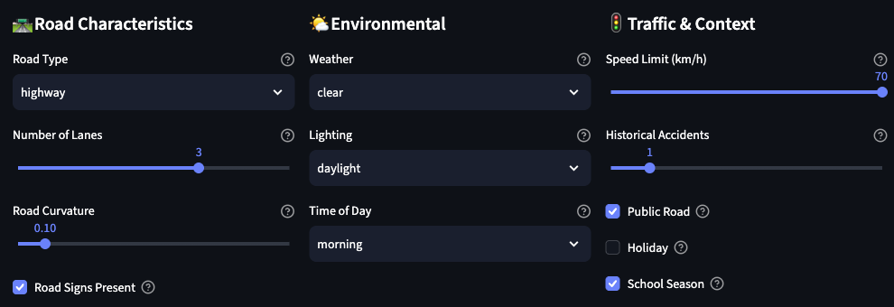
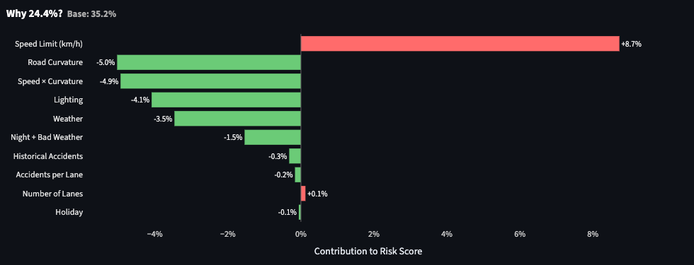
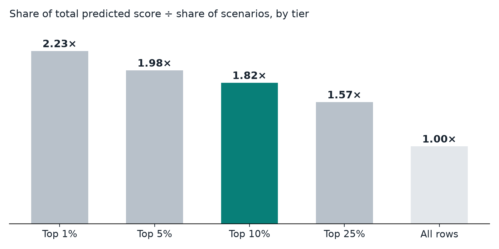

# Safe-Route

**Explainable risk scoring for infrastructure safety prioritization.**

[](https://github.com/roshanaryal1/SafeRoute/actions/workflows/ci.yml)
[](https://www.python.org/)
[](LICENSE)
[](https://roadaccident-roshanar-aryal.streamlit.app/)

Safe-Route scores a combination of road and environmental conditions and shows
which conditions raised or lowered the score, so a road safety engineer can
build a shortlist of conditions worth inspecting and check the reasoning behind
every entry. It is a working prototype trained on **synthetic data**; it does
not predict real crash probabilities.

| | |
|---|---|
| Status | Selected for presentation at the 4th International Conference on Smart Sustainable Development (SSD 2026), project showcase P21, Auckland, 27 November 2026 |
| Live demo | <https://roadaccident-roshanar-aryal.streamlit.app/> (free tier; allow about 90 seconds to wake) |
| Slides | [`ssd2026/presentation/`](ssd2026/presentation/) |
| Author | Roshan Aryal, Independent Researcher, Auckland, New Zealand |



## What it does

1. **Describe the road.** Road type, lanes, curvature, speed limit, lighting,
   weather, time of day, signage and calendar context.
2. **Get a score.** A Random Forest regressor (200 trees, max depth 12,
   15 inputs) scores the conditions from 0 to 1 and ranks the score against the
   training scenarios.
3. **See why.** TreeSHAP splits the gap between the average score and this
   score across the inputs.



*Example: highway, 70 km/h, daylight, clear weather, gentle curve. The speed
limit raised the score; curvature, lighting and weather lowered it. The app
shows the result as 24.4%; read it as a score of 0.244, not a one-in-four
chance of a crash.*

## Evidence

All figures below are on the synthetic Kaggle Playground Series S5E10 data
(517,754 rows).

| Measure | Value | Source |
|---|---|---|
| Holdout R² (random 80/20 split, reproduced 11 Aug 2026) | 0.8835 | [`ssd2026/MODEL_VALIDATION.md`](ssd2026/MODEL_VALIDATION.md) |
| Mean absolute error (0 to 1 scale) | 0.0443 | same |
| Five-fold CV R² standard deviation | 0.0003 | [`model/metadata.json`](model/metadata.json) |
| R² in daylight / dim / night | 0.857 / 0.851 / 0.846 | [`ssd2026/MODEL_VALIDATION.md`](ssd2026/MODEL_VALIDATION.md) |
| Share of total predicted score held by the top 10% of scenarios | 18.2% (1.82× its share) | [`ssd2026/CONCENTRATION.md`](ssd2026/CONCENTRATION.md), reproducible with `compute_concentration.py` |



R² here is the share of variation in the synthetic label explained on held-out
rows, not a share of crashes predicted. The concentration figure describes the
model's own scores; it is not a measured share of crashes or prevented harm.
A gradient-boosting alternative scored marginally higher (R² 0.8845) and was
declined to keep the verified evidence intact; see
[`ssd2026/MODEL_DECISION.md`](ssd2026/MODEL_DECISION.md).

## Responsible use

- Road and environmental conditions only: no driver identity or demographic
  data.
- Intended for infrastructure screening with human review, not for individual
  liability, enforcement or insurance pricing.
- Not yet validated on real crash outcomes, other places or later periods; the
  data has no locations or timestamps.

Full statement: [`ssd2026/RESPONSIBLE_AI.md`](ssd2026/RESPONSIBLE_AI.md).

## Quick start

```bash
git clone https://github.com/roshanaryal1/SafeRoute.git
cd SafeRoute
python3 -m venv .venv && source .venv/bin/activate
pip install -r requirements.txt
streamlit run streamlit_app.py
```

Retrain the model with `python3 train_and_save_model.py`. Run the tests with
`pip install pytest && pytest test_app.py`.

## Repository layout

| Path | Contents |
|---|---|
| `streamlit_app.py` | The web app |
| `src/` | Preprocessing, model utilities, recommendations, charts |
| `train_and_save_model.py` | Training script |
| `compute_concentration.py` | Reproduces the concentration table |
| `model/` | Trained model, encoders and `metadata.json` |
| `data/` | Kaggle Playground Series S5E10 training and test files |
| `ssd2026/` | SSD 2026 submission, validation, impact and responsible-AI notes, slides |
| `docs/images/` | README images |
| `test_app.py` | Test suite |

## Citation

See [`CITATION.cff`](CITATION.cff), or use GitHub's "Cite this repository".

## License

Code: [MIT](LICENSE). The training data comes from the Kaggle Playground
Series S5E10 competition and remains subject to Kaggle's competition terms.
